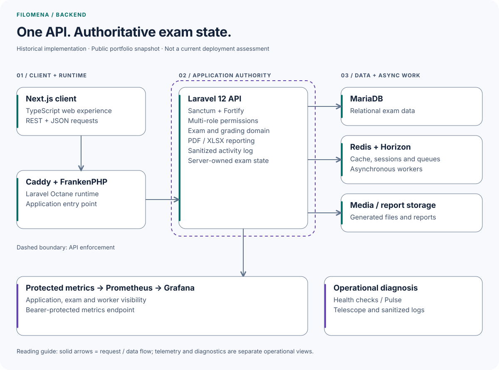
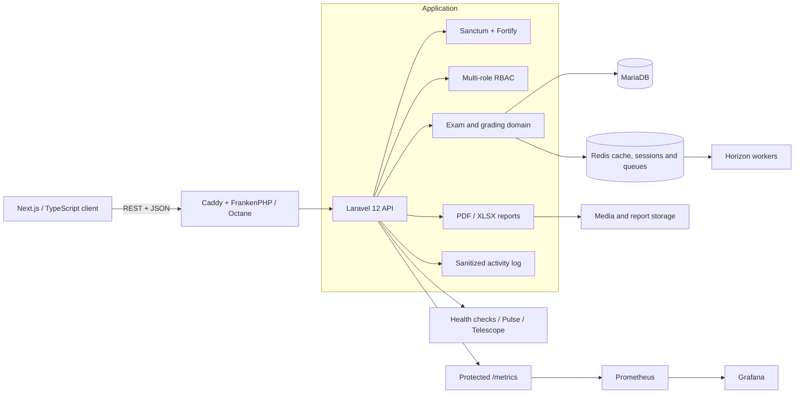

# Filomena Backend

**Production REST API for a health-sciences assessment platform adopted by five Argentine national institutions.** Filomena modernized a CakePHP + jQuery monolith into a decoupled Laravel and Next.js system built for concurrent exams, traceable grading and repeatable institutional deployments.

Historical public snapshot, maintained by Gonzalo Martin Perez as technical portfolio evidence. Versions and delivery configuration describe the published implementation.

[](https://www.php.net/)
[](https://laravel.com/)
[](#api-and-domain-capabilities)
[](#local-setup)
[](#portfolio-scope)

| Production evidence | Result |
|---|---:|
| Adopting institutions | **5** |
| Simultaneous exam users supported | **1,000+** |
| Average response on critical endpoints | **<300 ms** |
| End-to-end institutional deployment | **<15 min** |
| Universidad Nacional del Sur Final Year Project | **10/10** |

**[Read the full English case study →](https://vine-jupiter-8df.notion.site/Filomena-Production-Health-Sciences-Exam-Platform-367b68807486814ca99ad189ca70ff00)**

> The figures above are documented production outcomes from the project case study and professional profile. They are not synthetic benchmark results generated by this repository.

## Architecture

<picture>
  <source media="(prefers-color-scheme: dark)" srcset="docs/diagrams/architecture-dark.svg">
  
</picture>

The overview groups responsibilities in the published implementation. The editable logical view below retains the detailed relationships; neither view changes the historical architecture. [Diagram source and maintenance](docs/diagrams/README.md).

<details>
<summary>Detailed logical view · editable Mermaid</summary>



</details>

The API is the system boundary between the [Filomena frontend](https://github.com/gonzalomartinperez/filomena-frontend) and the exam domain. Docker Compose assembles the application runtime, MariaDB, Redis, queue workers and the observability stack for development and deployment.

## API and domain capabilities

| Area | What the backend handles |
|---|---|
| Exam lifecycle | Creation, publication, start, completion, defense and restoration flows |
| Assessment model | Exams, sections, clinical cases, questions, checklists and weighted items |
| Role-aware workflows | Administrator, evaluator and student capabilities enforced per route |
| Student experience | Exam navigation, answer persistence, progress state and pseudonym assignment |
| Evaluation | Corrections, item-level scores, defense scores and evaluator progress |
| Institutional operations | Bulk imports, user management, monitoring and repeatable seeded environments |
| Reporting | Exam structure, answers and corrections in PDF; grades and detailed corrections in XLSX |
| Asynchronous work | Queued report generation and password-reset delivery through Redis and Horizon |

## Backend engineering decisions

### Security and data boundaries

- Laravel Sanctum and Fortify provide token authentication and password flows.
- Spatie Permission enforces explicit route-level permissions and multi-role assignments.
- Student identities are separated from exam-facing pseudonyms.
- Per-exam role mappings and institutional scoping support data isolation.
- Login and password-reset endpoints are rate-limited.
- Activity logging recursively redacts passwords, tokens, authorization headers, cookies and other sensitive fields.
- Metrics require a bearer token supplied at runtime; example environments contain no reusable credentials.

### Performance and consistency

- Redis backs caching, sessions and queues; Laravel Horizon operates asynchronous workloads.
- SQL tuning plus Redis caching and queues produced the documented **<300 ms** average on critical endpoints.
- The deployed platform supported **1,000+ simultaneous exam users** with complete data consistency under peak load.
- Domain state models make student and evaluator progress explicit throughout an exam.

### Observability and operations

- Prometheus collectors cover application models, active users, exam composition, activity events, health and Horizon workload.
- Grafana provisioning is versioned alongside the application.
- Spatie Health validates database, cache, Redis, queues, scheduling and disk usage.
- Pulse, Telescope, structured logs and a sanitized request activity trail support diagnosis at different levels.
- Docker separates development and production targets around FrankenPHP and Laravel Octane.

### Verification

- PHPUnit 11 is wired through Laravel's test runner.
- Laravel Pint provides deterministic PHP formatting and Husky/lint-staged enforce it on staged PHP files.
- Vite has a production build path for the small set of backend-owned web assets.
- The public snapshot currently includes framework smoke tests; the production figures above come from deployed operation and load validation, not a committed benchmark harness.

## Technology

| Layer | Tools |
|---|---|
| Runtime and API | PHP 8.2+, Laravel 12, FrankenPHP, Laravel Octane, REST |
| Identity and authorization | Laravel Sanctum, Laravel Fortify, Spatie Permission |
| Persistence | MariaDB / MySQL, Eloquent, Redis, model caching |
| Async processing | Laravel Queue, Redis, Laravel Horizon |
| Files and reporting | Spatie Media Library, PDF generation, Laravel Excel |
| Observability | Prometheus, Grafana, Laravel Pulse, Telescope, Spatie Health, activity logs |
| Delivery | Docker, Docker Compose, Caddy; GitHub Actions in the documented deployment flow |
| Quality | PHPUnit, Laravel Pint, Husky, lint-staged, Vite |

## Portfolio scope

Filomena was Gonzalo Martin Perez's **Final Year Project at Universidad Nacional del Sur (Jan–Dec 2025)** and received a **10/10**. His documented scope spans architecture, the API-first modernization, backend and domain implementation, SQL/Redis performance work, containerized delivery, observability and production deployment.

The platform exists in an institutional context and this repository does not claim exclusive authorship of every project artifact. It is published with authorization as a professional portfolio and technical reference. No open-source license is granted by this repository.

## Local setup

### Docker Compose (recommended)

Requirements: Docker Engine and Docker Compose v2. On Windows, use Docker Desktop with WSL 2 integration. Use a dedicated local checkout, a distinct `COMPOSE_PROJECT_NAME` and available ports. The API port is not restricted to loopback in the Compose files; review host exposure before starting. Do not point the example stack at institutional services or data.

```bash
cp .env.example.docker .env
```

Before starting, set unique values for:

- `DB_PASSWORD`
- `PROMETHEUS_BEARER_TOKEN`
- `GRAFANA_PASSWORD`
- every `INITIAL_ADMIN_*` variable
- `DEMO_USER_PASSWORD` for development seed data

Do not commit `.env`. `APP_KEY` is generated locally on first startup.

```bash
./run.sh dev
```

The default local endpoints are:

| Service | URL |
|---|---|
| API | `http://localhost:8000` |
| Health check | `http://localhost:8000/api/health` |
| phpMyAdmin | `http://localhost:8080` |
| Prometheus | `http://localhost:9090` |
| Grafana | `http://localhost:9091` |

Operational commands:

```bash
./run.sh dev --build   # rebuild and start development
./run.sh prod --build  # rebuild and start the production profile
./run.sh off           # stop both profiles and preserve volumes
./run.sh reset         # destructive: remove project volumes and orphan containers
```

The script stops both named modes before starting the selected one; it is not a zero-downtime deployment command. `reset` can delete the production-profile database, application storage and monitoring volumes. Use it only with disposable local data. The development database has no declared persistent data volume. Historical images include mutable tags; the `prod` profile is a reference configuration, not a current security or deployment-readiness certification.

### Native toolchain

```bash
cp .env.example.local .env
composer install
npm ci
php artisan key:generate
php artisan migrate --seed
npm run build
php artisan test
```

The same required administrator and development credentials must be configured before seeding.

## Repository map

| Path | Responsibility |
|---|---|
| `app/Http/Controllers/Api/` | REST application layer |
| `app/Models/` | Exam, assessment, identity and grading domain |
| `app/Services/` | Scoring, pseudonym and evaluator-state logic |
| `app/Jobs/` | Asynchronous reports and password delivery |
| `app/Prometheus/Collectors/` | Application and domain metrics |
| `database/` | Schema, factories and reproducible seed data |
| `docker/` | Runtime images plus Grafana and Prometheus provisioning |
| `routes/api.php` | Authenticated and permission-gated API surface |
| `tests/` | PHPUnit test harness |

## Related project and evidence

- [Filomena frontend](https://github.com/gonzalomartinperez/filomena-frontend)
- [English case study](https://vine-jupiter-8df.notion.site/Filomena-Production-Health-Sciences-Exam-Platform-367b68807486814ca99ad189ca70ff00)
- [Caso de estudio en español](https://vine-jupiter-8df.notion.site/Filomena-Plataforma-Productiva-de-Ex-menes-de-Ciencias-de-la-Salud-29ab68807486806db025cfeef5de9f73)

## Maintenance and security

This is an owner-maintained portfolio reference, not a community support service. See [CONTRIBUTING.md](CONTRIBUTING.md) for scope and validation, and [SECURITY.md](SECURITY.md) for private reporting and safe handling of institutional data. Dependency changes require manual review; an open update PR is not evidence that the snapshot has been upgraded or verified.

---

Built as an academic capstone; operated as a production platform.
